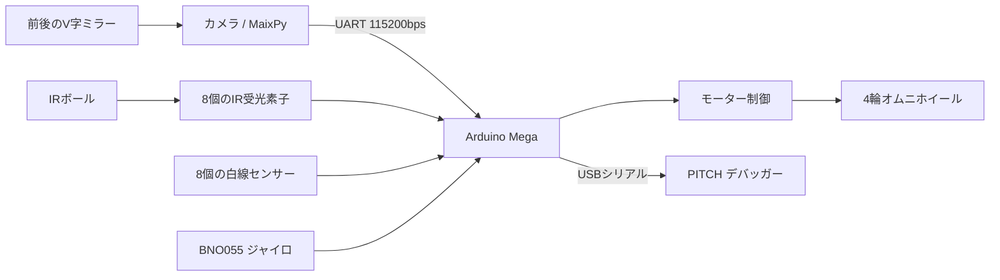

# ロボット全体の動作

このマシンは、カメラ・IR・白線・ジャイロの情報を組み合わせて、4つのオムニホイールを動かします。ロボットサッカーの制御を学ぶための実装例です。機体の構造、センサーの向き、床や照明によって調整値は変わります。自分の機体に使う場合は、各センサーを単独で確認してから組み合わせてください。

マイコンはArduino Mega Pro Mini、カメラはUnitV AI CameraのOV7740・M12レンズ版、IR受光素子はTSSP58038です。BNO055で姿勢を読み、DRV8874を介してIG22 DCモーター4個を駆動します。部品の一覧と出典は[プロジェクトREADME](../README.md#使用デバイス)にあります。

## 構成と情報の流れ

カメラでは画像を処理し、検出した物体の方向などをArduinoへ送ります。ArduinoはIRと白線センサー、ジャイロも読み、移動方向と姿勢を決めます。PITCHはArduinoから送られる値を表示する観測用アプリです。画像そのものをArduinoに送っているわけではありません。

方向は機体から見た角度で、右0°・前90°・左180°・後ろ270°です。値 `-1` は対象が検出できない場合に使います。ジャイロの `yaw` は別の方位基準であり、電源を入れた方向が自動的に0°になる処理はありません。

## 繰り返し処理

[src/main.cpp](../src/main.cpp) の `loop()` が次を繰り返します。

1. `readControlFrame()` でIR、ジャイロ、カメラ、必要に応じて白線を読みます。走行に使うボールの角度とゴールに対する姿勢のずれを計算します。
2. `publishTelemetry()` が約250msごとに観測値をUSBへ送ります。
3. `SPEED` が0なら姿勢検証、それ以外は設定した攻撃または守備を実行します。
4. 決めた移動方向・PWM・姿勢のずれを `MotorController` へ渡します。

守備設定では通常、制御用の白線読み取りを省きます。PITCH用の表示では別インスタンスで白線を観測します。守備から攻撃に移ったときは、制御用白線センサーを使います。

## 攻撃 OFFENSE

相手ゴールの方向をカメラで得られれば、そこへ機体前方を向ける姿勢目標を作ります。見失ったときは目標を一時保持し、期限を過ぎるとジャイロの0°を目標にします。

ボールは設定が有効ならカメラを優先し、見えなければIRを使います。正面に近いときは前進し、左右や後方にあるときは回り込む移動方向を選びます。前方の検出揺れで進路が切り替わりすぎないよう、直進を維持する範囲と移動方向の変化速度の制限があります。白線を検出した場合は、白線の向きとボール方向に応じて停止または退避します。

処理は `runOffense()` と `calculateWrapAroundAngle()`、直進判定は [OffenseStraightApproach.cpp](../lib/DefenseController/OffenseStraightApproach.cpp)、白線処理と車輪配分は [MotorController.cpp](../lib/MotorController/MotorController.cpp) です。

## 守備 DEFENSE

自ゴールを機体の後ろに向け、ボールの左右に合わせて横移動します。守備中のボール方向はIRを優先し、IRが未検出ならカメラを使います。ゴール下端の画像上の位置を使い、近すぎれば前へ、遠すぎれば後ろへ戻る指令を横移動に重ねます。

自ゴールが見えなくてもカメラからの通信が続いていれば、ジャイロ0°付近に整列し、左右を確認しながら後退します。カメラ通信が途切れた通常守備では停止します。ゴール下端が測定できない場合は並進を控えて姿勢を保ちます。

前方カメラでボールが5秒間連続して見えると、最大10秒の一時攻撃に移ります。時間は [DefenseConfig.h](../lib/DefenseController/DefenseConfig.h) で設定できます。一時攻撃は単独OFFENSEと同じ `runOffense()` を使います。開始時に自ゴール前で白線を踏んでいるなどの条件が揃うと、短時間の白線離脱が先に入ります。攻撃時間にはこの離脱時間も含まれます。攻撃中の通信断時は、ボールがIRで見えていれば攻撃が続きます。

状態の判定は [DefenseController.cpp](../lib/DefenseController/DefenseController.cpp)、ゴールとの位置調整は [GoalEdgeGuard.cpp](../lib/DefenseController/GoalEdgeGuard.cpp) と [GoalReturn.cpp](../lib/DefenseController/GoalReturn.cpp)、走行の優先順は `runDefense()` を確認してください。詳しい閾値は [守備の説明](../camera/DEFENSE.md) にあります。

## 設定と調整

| 設定するもの | ファイル |
| --- | --- |
| 攻守、攻撃ゴール色、走行PWM、センサーの有効・無効、守備位置の画素閾値 | [RobotConfig.h](../src/RobotConfig.h) |
| 守備中の横速度、一時攻撃の時間、攻守で使う動作の細かな調整 | [DefenseConfig.h](../lib/DefenseController/DefenseConfig.h) |
| 通常走行の姿勢補正と白線判定 | [MotorControllerConfig.h](../lib/MotorController/MotorControllerConfig.h) |
| カメラのROI・色閾値・視野角 | [V-mirror.py](../camera/V-mirror.py) |

`bottomGap` は距離そのものではなく画像上の画素数です。調整するときは、実際のゴールラインから機体中心までの距離を測り、後方の向きやカメラ映像も記録します。ミラーを傾けたり取り付け位置を変えたりした場合は校正し直してください。

## 実機で確認する順序

1. 車輪が浮くように機体を支え、Arduinoとカメラそれぞれの電源・通信を確認します。
2. PITCHで `camera`、`ir`、`cameraBall`、`line`、`yaw`、`error` を見ながら、物体を前後左右に動かし、表示方向と実物を照合します。
3. `SPEED=0` でゴールへ正しく向き直るか確認します。0にすると姿勢テストになるため、通常走行へ戻すときは元の値にします。
4. 床上で停止できるよう見守りながら、ボール追従、白線、守備位置、攻守切り替えを一つずつ試します。USB接続・書き込みでArduinoが再起動する場合があります。

表示値と実際の動きが異なる場合は、まず書き込まれたファームウェアと設定を確認します。以前の測定ではアルカリ単3電池8本を使い、走行中に電圧が低下しました。電源状態も走行速度に影響しますが、現在も同じ状態とは限らないため、その場で測定してください。
